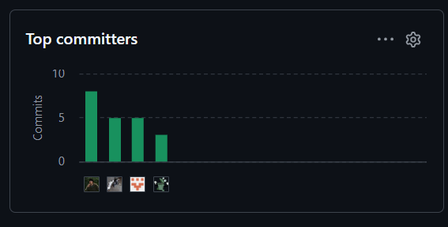

# Project Report Collaboration Insights

## Repositorio del Project Report

**URL:** [Report - TheSuccesfulOnes](https://github.com/TheSuccesfulOnes/Report)

## Desarrollo de las actividades de elaboración del informe - AV1

Durante el Avance 1, el equipo trabajó de manera colaborativa en la definición del problema, la investigación de usuarios, la especificación de requisitos, el diseño inicial de la solución y la integración de la evidencia de implementación. La coordinación permitió consolidar los cinco capítulos del informe y mantener una presentación común para la versión AV1.

## Evidencia de colaboración en GitHub - AV1

La siguiente imagen presenta de forma agregada la actividad del equipo en el repositorio del informe durante el AV1.

{width=70%}

## Desarrollo de las actividades de elaboración del informe - Trabajo Parcial

Entre el 19 de septiembre y el 8 de octubre de 2026, el equipo actualizó el informe para el Trabajo Parcial: se revisó la especificación de requisitos y la trazabilidad de las User Stories, se incorporaron los Capítulos VI y VII, se actualizaron las evidencias de implementación y despliegue y se amplió la sección de Student Outcome. En ese periodo el repositorio del informe registra 5 commits (3 de Cayanchi Avila y 2 de Asto Jacome); en los repositorios del producto, el backend registra 6 commits (5 de Ávalos Cordova y 1 de Asto Jacome) y los frontends web, de administración y móvil registran 6, 4 y 4 commits de Ávalos Cordova.

## Evidencia de colaboración en GitHub - Trabajo Parcial

[Agregar aquí la captura agregada de la colaboración del repositorio del informe correspondiente al Trabajo Parcial.]

## Desarrollo de las actividades de elaboración del informe - AV2

Entre el 9 de octubre y el 8 de noviembre de 2026, el trabajo del informe se concentró en los Capítulos VI, VII y VIII. El 4 de noviembre se incorporó un borrador que amplió la verificación y validación, el diseño de entrevistas y auditorías UX, la monitorización DevOps y la planificación y el diseño de los experimentos. Después, se revisó su estructura frente al enunciado del Avance 2 en una rama de trabajo (`feature/av2-correcciones`), conforme a GitFlow, y se actualizaron el Student Outcome, el Registro de Versiones y el anexo de videos. En los repositorios del producto, el 9 de octubre se corrigió el inicio de sesión del backend y de las tres aplicaciones (normalización de identificadores de acceso y selectores estables de autenticación).

La siguiente tabla resume los commits verificables en GitHub entre el 9 de octubre y el 8 de noviembre de 2026:

| Repositorio | Commits | Autoría |
| :--- | :--- | :--- |
| Report | 1 | Asto Jacome |
| Backend-SafeSpace | 1 | Ávalos Cordova |
| Frontend-Web-SafeSpace | 1 | Ávalos Cordova |
| Frontend-Admin-SafeSpace | 1 | Ávalos Cordova |
| Frontend-Movil-SafeSapace | 2 | Ávalos Cordova |

La actividad registrada en GitHub se concentra en pocos integrantes durante este periodo. En el Shareback interno del 06/11/2026 participaron los integrantes actuales del equipo y se compartieron los resultados agregados de las sesiones, la lentitud observada en los despliegues y la solicitud de publicar SafeSpace en Google Play. Los hallazgos y su traducción en oportunidades de trabajo se resumen en la sección 8.3.4. La distribución individual de tareas que no queda reflejada en los commits no se atribuye sin un registro que la respalde.

## Evidencia de colaboración en GitHub - AV2

[Agregar aquí la captura agregada de la colaboración del repositorio del informe y de los repositorios del producto correspondiente al AV2, tomada de GitHub (Insights → Contributors) con el periodo del 9 de octubre al 8 de noviembre de 2026.]

\newpage
