# Capítulo VI: Product Verification & Validation

Este capítulo reúne pruebas del backend y de la aplicación web, escenarios de aceptación vinculados con las historias del Capítulo III y capturas de la interfaz móvil. El backend usa Java 21, Spring Boot 3.5.5, JUnit 5, Mockito y Cucumber; la aplicación web usa React, TypeScript, Vitest y Playwright.

## 6.1. Testing Suites & Validation

La corrida integral realizada para esta revisión ejecutó el backend con Temurin Java 21 y Maven 3.9.11 el 08/11/2026. El proceso terminó correctamente con **967 pruebas, 0 fallas, 0 errores y 0 omitidas**. Los otros registros que figuran en la tabla corresponden a ejecuciones anteriores y se conservan como tales, sin sumarlos ni presentarlos como el resultado actual.

| Producto/evidencia | Fuente | Resultado que declara |
| :--- | :--- | :--- |
| Backend, corrida integral de esta revisión | Maven 3.9.11; Temurin Java 21; copia local conectada | 967 pruebas; 0 fallas, 0 errores y 0 omitidas; BUILD SUCCESS (08/11/2026). |
| Backend, ejecución documentada anterior | Backend-SafeSpace/TESTING.md | 960 casos en 60 suites; 488 unitarios y 472 de integración local; 0 fallas, errores u omitidos. |
| Backend, inventario JSON anterior | src/test/resources/validation-inventory.json | 966 casos en 60 suites; 0 fallas, errores u omitidos. |
| Backend, captura anterior de GitHub Actions | backend-ci-summary.png | 958 pruebas aprobadas en una ejecución identificada en la captura como 06/10/2026. |
| Frontend web, pruebas unitarias e integración local | Frontend-Web-SafeSpace/TESTING.md | 494 casos aprobados: 489 Vitest y 5 casos Node conservados. |
| Frontend web, pruebas de sistema con Playwright | playwright-report-summary-current.png | 6 casos aprobados; 0 fallidos, inestables u omitidos. |
| Integración continua | Backend-SafeSpace/.github/workflows/ci.yml | Existe un workflow de backend; no se encontró un workflow GitHub Actions en el repositorio conectado del frontend web. |

La corrida de esta revisión se ejecutó sobre la copia local conectada al repositorio y no reemplaza un nuevo registro de GitHub Actions. Los artefactos históricos del backend declaran 960, 966 y 958 casos, respectivamente; reflejan versiones o ejecuciones distintas del total actual. El frontend informa 494 casos en `TESTING.md`; el resultado de Playwright disponible corresponde a seis pruebas End-to-End aprobadas. Typecheck y lint se ejecutaron en esta revisión y se detallan en 6.2.1.

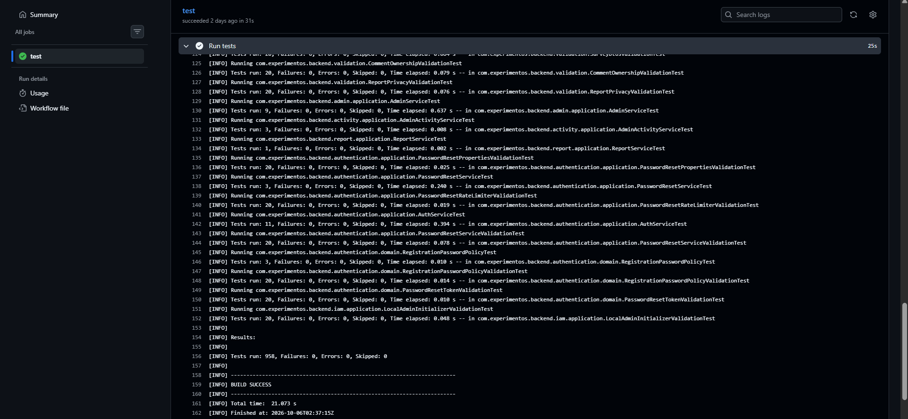

### 6.1.1. Core Entities Unit Tests

Las suites unitarias se organizan por entidad y comportamiento. Cada caso indica qué comprueba y muestra el resultado de su ejecución.

#### Registro e inicio de sesión — AuthServiceTest (US01–US02)

Ubicación: `src/test/java/com/experimentos/backend/authentication/application/AuthServiceTest.java`.

Verifica el registro de empleados, la codificación de contraseñas y el rechazo de contraseñas no coincidentes, débiles o de credenciales inválidas. La corrida integral de esta revisión registró **12 pruebas aprobadas, 0 fallas y 0 errores** en esta suite. La captura individual que acompaña el ejemplo corresponde a una ejecución anterior de 11 pruebas.

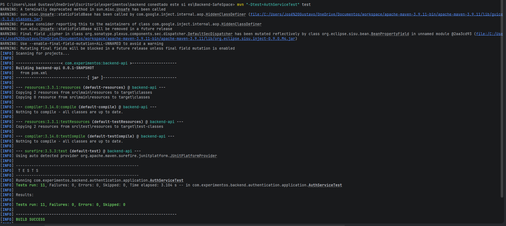

#### Registro diario y resumen de ánimo — MoodServiceTest (US06–US07)

Ubicación: `src/test/java/com/experimentos/backend/mood/application/MoodServiceTest.java`.

Comprueba el registro diario único, el rechazo de registros duplicados y el cálculo del resumen anónimo según la fecha de negocio. La ejecución individual terminó con **4 pruebas aprobadas, 0 fallas y 0 errores**.

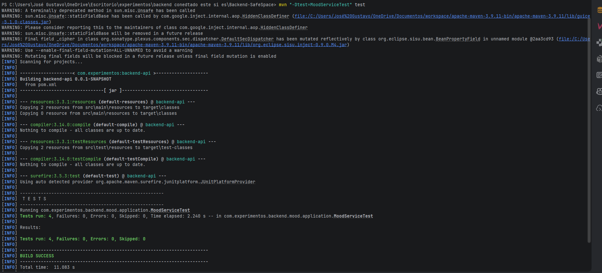

#### Consulta y respuesta a encuestas — SurveyServiceTest (US08–US09)

Ubicación: `src/test/java/com/experimentos/backend/survey/application/SurveyServiceTest.java`.

Comprueba el indicador de respuesta del usuario, la prevención de respuestas duplicadas y la publicación anónima de la respuesta como comentario raíz. La ejecución individual terminó con **3 pruebas aprobadas, 0 fallas y 0 errores**.

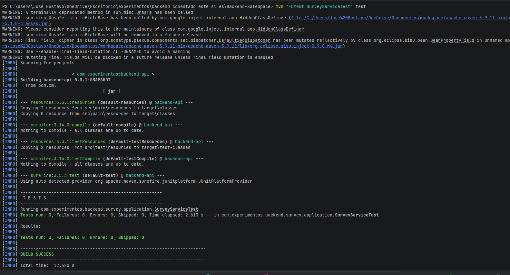

Fragmento representativo de la prueba que impide guardar una segunda respuesta:

```java
assertThatThrownBy(
        () -> service().answer(10L, new SurveyDtos.AnswerRequest("A second answer")))
    .isInstanceOf(IllegalArgumentException.class)
    .hasMessage("Survey has already been answered");
verify(answers, never()).save(any());
verify(comments, never()).save(any());
```

Fuente: `src/test/java/com/experimentos/backend/survey/application/SurveyServiceTest.java`.

#### Privacidad de reportes anónimos — ReportServiceTest (US17–US18)

Ubicación: `src/test/java/com/experimentos/backend/report/application/ReportServiceTest.java`.

Comprueba que la respuesta de la API omita el nombre del remitente cuando el reporte está marcado como anónimo. La prueba también conserva una referencia interna a la cuenta del empleado; por ello verifica el ocultamiento del nombre en la respuesta, pero no el anonimato de los datos almacenados. Esta diferencia se describe en el hallazgo SEC-01 de 6.2.1.2. La ejecución individual terminó con **1 prueba aprobada, 0 fallas y 0 errores**.

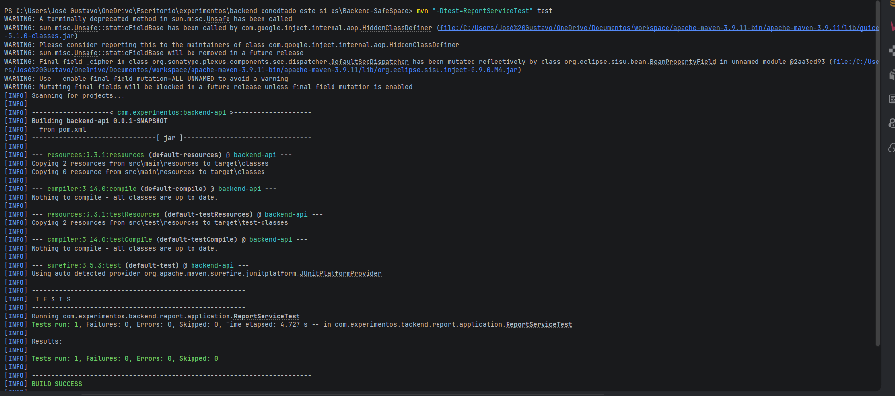

Fragmento representativo de las aserciones de privacidad y propiedad del reporte:

```java
assertThat(created.reporterDisplayName()).isNull();
assertThat(ReflectionTestUtils.getField(saved, "user")).isSameAs(employee);
```

Fuente: `src/test/java/com/experimentos/backend/report/application/ReportServiceTest.java`.

**Resultado de las cuatro suites en la corrida integral actual: 20 pruebas aprobadas, 0 fallas y 0 errores.** Las capturas individuales se conservan como ejemplos de ejecución; en `AuthServiceTest` la imagen corresponde a una corrida previa con 11 casos.

### 6.1.2. Core Integration Tests

Las pruebas de integración componen módulos en un entorno local para comprobar su comunicación. El inventario del backend clasifica **472 ejecuciones como integración local**. Las suites de esta sección son una muestra representativa de seguridad HTTP, validación de solicitudes, servicios, persistencia y adaptadores externos. Cuando una suite mezcla unitarias e integración, se indica el desglose del inventario; la captura corresponde a la ejecución completa de esa clase.

#### Seguridad de controladores y rutas protegidas

Estas cinco suites usan `MockMvc` y la cadena real de Spring Security/JWT para probar acceso HTTP, roles permitidos, tokens ausentes o inválidos, cuentas deshabilitadas/eliminadas y ausencia de sesión de servidor. Los servicios y el repositorio de usuarios son dobles locales; no se consulta infraestructura desplegada. Cada suite contiene 20 escenarios; juntas aportan **100 casos de integración**.

| Suite | Ruta protegida | Qué comprueba |
| :--- | :--- | :--- |
| `ActivityControllerSecurityTest` | `/api/v1/activities/managed` | Acceso autorizado a actividades administradas y rechazo de identidades/tokens no válidos. |
| `MoodControllerSecurityTest` | `/api/v1/mood/summary` | Protección del resumen de ánimo frente a roles, cuentas y tokens no autorizados. |
| `AiChatControllerSecurityTest` | `/api/v1/ai/conversations` | Control de autenticación y autorización del endpoint de conversaciones. |
| `SurveyControllerSecurityTest` | `/api/v1/surveys/managed` | Control de acceso a la consulta administrativa de encuestas. |
| `ReportControllerSecurityTest` | `/api/v1/reports` | Protección de la consulta de reportes y validación de la identidad vigente. |

Ubicación de las clases: `src/test/java/com/experimentos/backend/validation/`.

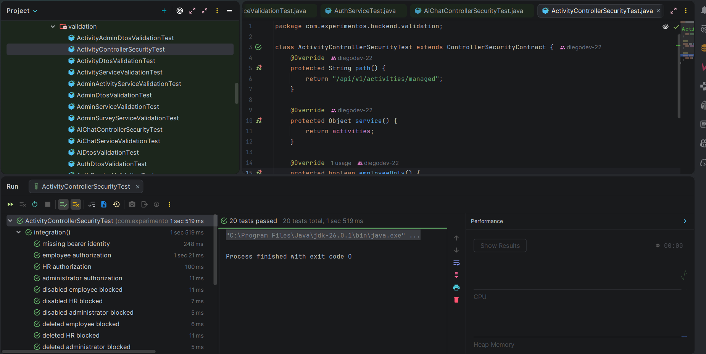

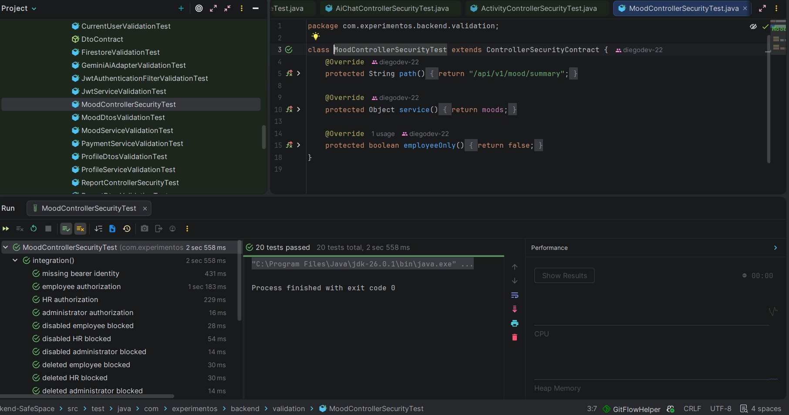

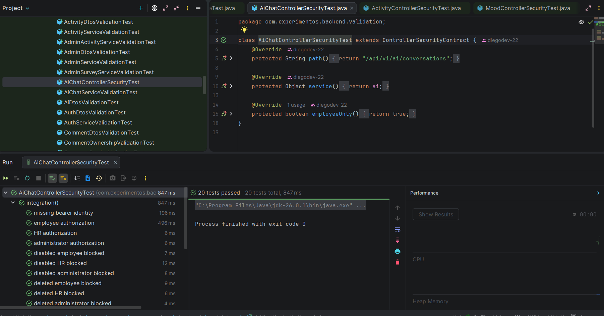

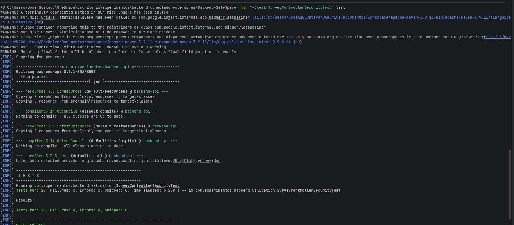

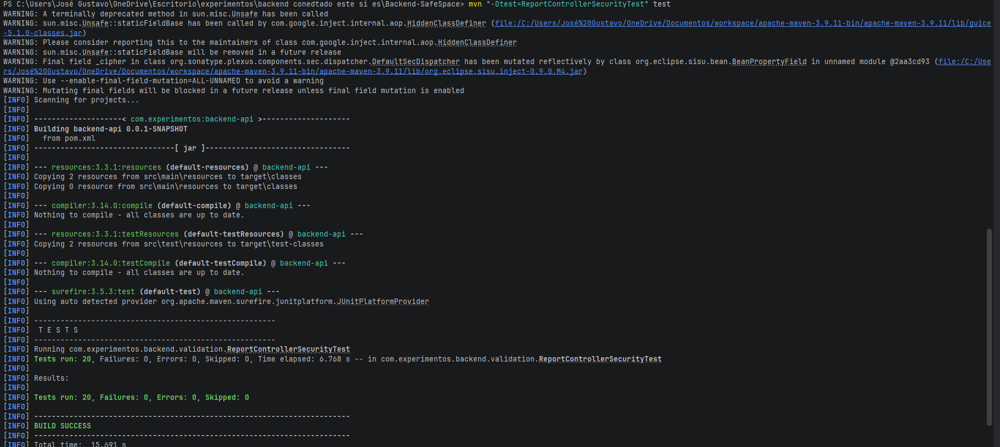

#### Contrato HTTP y reglas del servicio de encuestas

`SurveyDtosValidationTest` prueba solicitudes de creación y respuesta a encuestas: campos obligatorios, valores en blanco, límites de longitud, tipos admitidos y payloads válidos. Combina validación/decodificación HTTP con validaciones unitarias; su desglose es **20 casos (10 unitarios y 10 de integración)**.

`SurveyServiceValidationTest` protege el ciclo de respuesta: encuesta inexistente, no publicada o cerrada, permisos, respuestas vacías/duplicadas, persistencia de respuesta y comentario anónimo, y compensación si falla una escritura. La suite contiene **20 casos (12 unitarios y 8 de integración HTTP)**.

Ambas clases están en `src/test/java/com/experimentos/backend/validation/`.

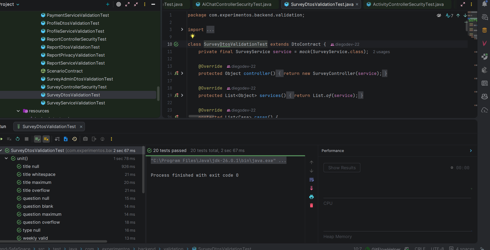

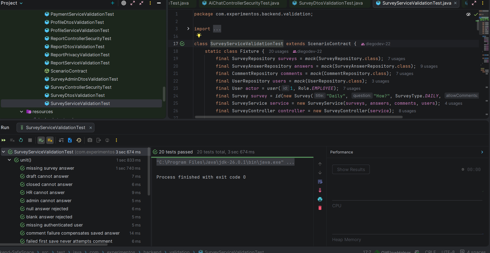

#### Persistencia Firestore y claves compuestas

`FirestoreValidationTest` verifica la traducción de entidades a documentos y su hidratación, la protección de hashes de contraseña en entidades relacionadas y el manejo de lecturas/escrituras fallidas. Usa Firestore simulado: **20 casos, 12 unitarios y 8 de integración local**; no conecta con una base desplegada.

`CompositeIdRepositoryTest` comprueba que los repositorios de votos de actividad y likes de comentarios usen el identificador compuesto correcto al eliminar documentos. Son **2 pruebas de integración local** con el SDK de Firestore simulado.

Ubicaciones: `src/test/java/com/experimentos/backend/validation/FirestoreValidationTest.java` y `src/test/java/com/experimentos/backend/shared/infrastructure/firebase/repositories/CompositeIdRepositoryTest.java`.

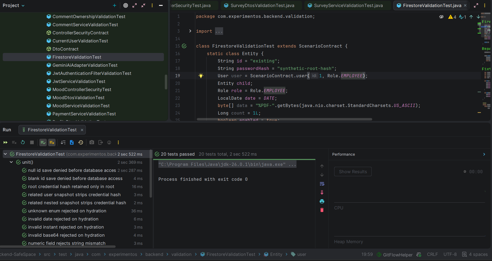

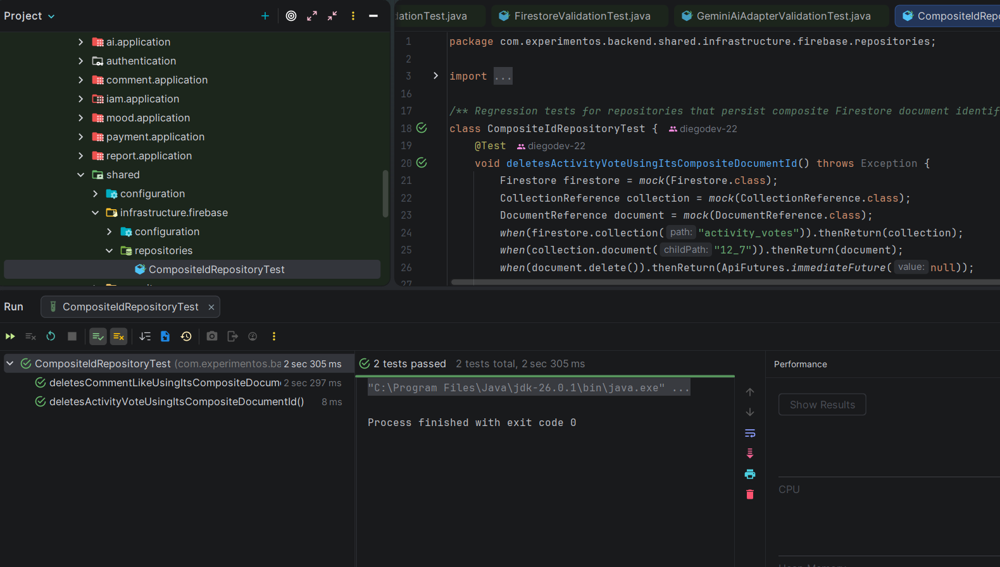

#### Adaptador HTTP del proveedor de IA

`GeminiAiAdapterValidationTest` verifica la solicitud REST del adaptador —URL, método, cabecera y contenido— y el tratamiento de respuestas vacías o malformadas, errores HTTP 429 y fallas de transporte. `MockRestServiceServer` intercepta las llamadas, por lo que no se contacta a Gemini. La suite mostrada contiene **20 casos (2 unitarios y 18 de integración local)**.

Ubicación: `src/test/java/com/experimentos/backend/validation/GeminiAiAdapterValidationTest.java`.

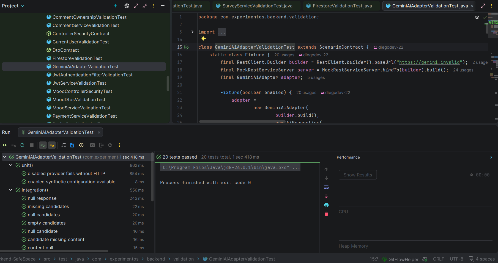

Fragmento del contrato común: crea solicitudes HTTP con `MockMvc`, aplica la cadena de filtros de seguridad y comprueba la respuesta y el carácter stateless de la API.

```java
var result = MockMvcBuilders.webAppContextSetup(context)
        .addFilters(chain)
        .build()
        .perform(request)
        .andReturn();

assertThat(result.getResponse().getStatus()).isEqualTo(expected);
assertThat(result.getRequest().getSession(false)).isNull();
```

Fuente: `src/test/java/com/experimentos/backend/validation/ControllerSecurityContract.java`.

En conjunto, las suites de seguridad mostradas registran **100 pruebas aprobadas**. Las demás capturas muestran ejecuciones completas de suites mixtas o de integración local, con sus conteos separados arriba. Esta evidencia no se presenta como prueba end-to-end ni como conexión a servicios externos desplegados.

### 6.1.3. Core Behavior-Driven Development

Se implementó BDD con **Cucumber JVM 7.20.1**. Cuatro archivos `.feature` expresan criterios de aceptación ejecutables para flujos del producto: respuesta de encuestas, registro diario de ánimo, votación de actividades semanales y privacidad de reportes. Cada escenario se ejecuta como una prueba dinámica de JUnit 5 a través del controlador y el servicio correspondientes, usando `MockMvc` y repositorios simulados. Esto valida el comportamiento HTTP y de aplicación localmente; no se presenta como prueba end-to-end ni como conexión a Firestore.

La suite BDD contiene **8 escenarios y 33 pasos aprobados** en la ejecución documentada. Los pasos se encuentran en clases Java separadas por flujo bajo `src/test/java/com/experimentos/backend/validation/bdd/`; `CoreBehaviorBddTest.java` ejecuta los escenarios de `src/test/resources/features/`. Esta cifra describe los escenarios BDD y no resuelve la discrepancia de totales Maven registrada en la tabla inicial. Los archivos BDD aparecen como cambios locales sin confirmar en el repositorio conectado; su resultado no se atribuye a una ejecución del workflow remoto.

#### Respuesta a encuestas — `survey-answer.feature`

```gherkin
Feature: Answer a weekly wellbeing survey
  Employees can submit one response to an open survey.

  Scenario: An employee submits a response successfully
    Given a published weekly survey is available to an employee
    When the employee submits the response "The app feels clear"
    Then the API responds with HTTP status 200
    And the answer and its root comment are persisted

  Scenario: An employee cannot submit a duplicate response
    Given a published weekly survey is available to an employee
    And the employee has already answered this survey
    When the employee submits the response "The app feels clear"
    Then the API responds with HTTP status 400
    And no additional answer or comment is persisted
```

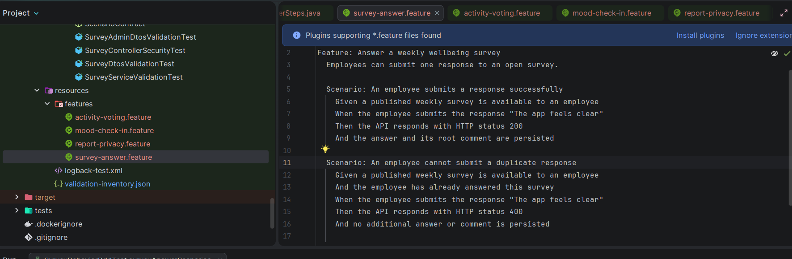

#### Registro de ánimo diario — `mood-check-in.feature`

```gherkin
Feature: Daily mood check-in
  Employees can record how they feel once per business day.

  Scenario: An employee records today's mood
    Given the employee has not recorded a mood today
    When the employee submits the mood "GOOD"
    Then the mood API confirms the submission with HTTP status 200
    And the mood is stored for the current business date

  Scenario: An employee cannot submit a second mood on the same day
    Given the employee has already recorded a mood today
    When the employee submits the mood "VERY_GOOD"
    Then the mood API confirms the submission with HTTP status 400
    And no mood entry is saved
```

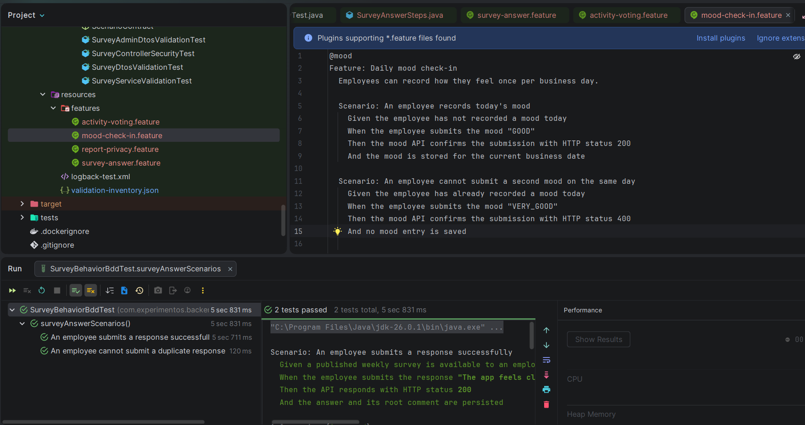

#### Votación de actividades — `activity-voting.feature`

```gherkin
Feature: Vote on a weekly team activity
  Employees can select an option and change their vote while the activity is open.

  Scenario: An employee votes for an open activity option
    Given an employee has not voted on the open activity
    When the employee votes for "Yoga"
    Then the activity vote is accepted with HTTP status 200
    And the selected activity option is persisted

  Scenario: An employee can replace their activity vote
    Given an employee has already selected "Yoga" on the open activity
    When the employee votes for "Walk"
    Then the activity vote is accepted with HTTP status 200
    And the previous vote is replaced by the selected option
```

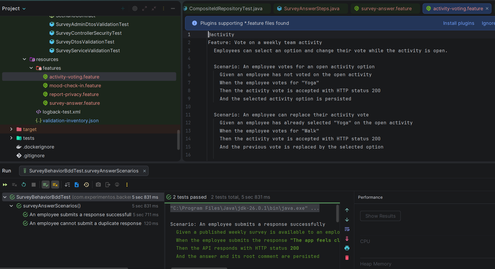

#### Privacidad de reportes — `report-privacy.feature`

```gherkin
Feature: Protect identity when submitting a workplace report
  Employees may choose whether their identity is disclosed in a report.

  Scenario: An anonymous report hides the reporter's identity
    Given the employee chooses to submit the report anonymously
    When the employee submits a workplace report
    Then the report API confirms creation with HTTP status 200
    And the response does not disclose the reporter's identity

  Scenario: An identified report shows the reporter's name
    Given the employee chooses to submit the report with their identity
    When the employee submits a workplace report
    Then the report API confirms creation with HTTP status 200
    And the response includes the reporter's display name
```

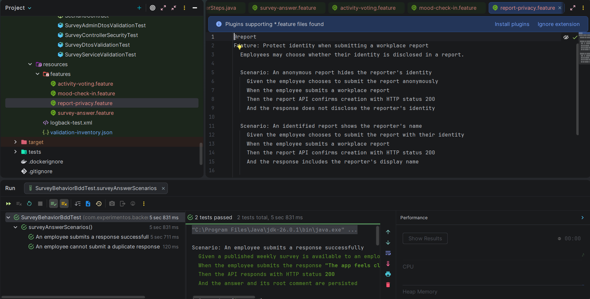

| Feature | Escenarios | Qué valida |
| :--- | ---: | :--- |
| `survey-answer.feature` | 2 | Envío válido y rechazo de respuesta duplicada; persiste respuesta y comentario raíz. |
| `mood-check-in.feature` | 2 | Registro del ánimo del día y rechazo de un segundo registro diario. |
| `activity-voting.feature` | 2 | Voto por una opción abierta y reemplazo del voto anterior. |
| `report-privacy.feature` | 2 | Creación de reportes anónimos e identificados y exposición de identidad según elección. |

En conjunto, los escenarios cubren resultados aceptados y rechazados, persistencia esperada y reglas de privacidad. Las capturas ubicadas junto a cada feature documentan los archivos Gherkin en el IDE; sus paneles inferiores muestran una ejecución previa de solo dos escenarios de encuestas y no se toman como evidencia de la suite ampliada.

#### Evidencia de ejecución

La ejecución de `CoreBehaviorBddTest` muestra los **8 escenarios aprobados** de las cuatro features.

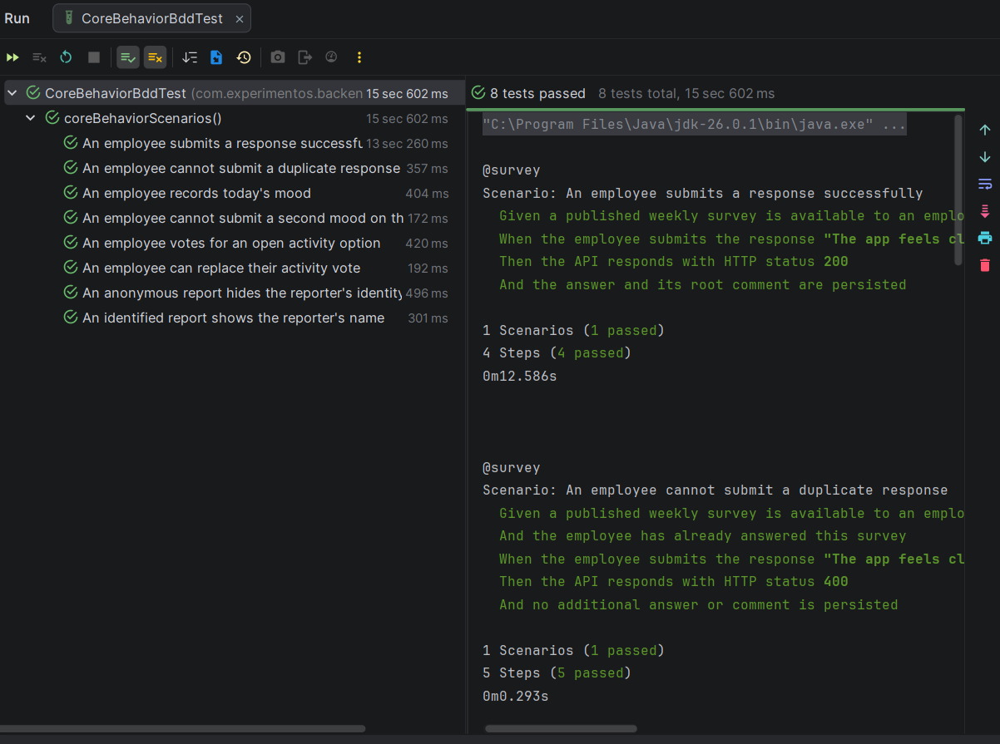

### 6.1.4. Core System Tests

#### Pruebas de sistema web con Playwright

Se ejecutaron seis recorridos de usuario en Chromium. Cada caso parte de una historia de usuario y verifica el flujo en la interfaz, la respuesta visible y la solicitud enviada a la API. La suite está en `Frontend-Web-SafeSpace/tests/e2e/core-system.spec.ts` y se ejecutó con `npm run test:e2e -- --workers=1`.

##### US06 — Registro diario de estado de ánimo

**User story.** Como usuario autenticado, quiero registrar mi estado de ánimo del día, para dejar constancia de mi percepción diaria de bienestar.

**Prueba ejecutada.** El empleado inicia sesión, selecciona “Muy bien” y la interfaz confirma el registro. La prueba verifica la solicitud `POST /api/v1/mood/today` con `mood: VERY_GOOD`.

**Resultado:** aprobada (1/1).

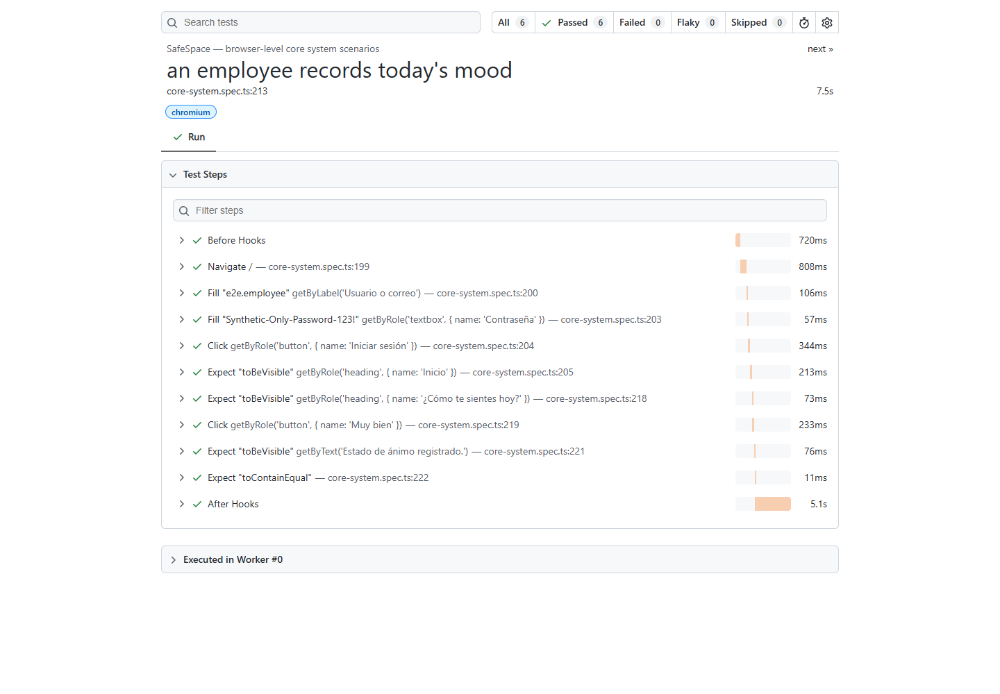

##### US07 — Resumen administrativo de estado de ánimo

**User story.** Como miembro de RR. HH. o administrador del sistema, quiero consultar la distribución diaria de estados de ánimo y la tasa de respuesta, para conocer el pulso general de los empleados.

**Prueba ejecutada.** Un usuario de RR. HH. inicia sesión y consulta un resumen con 8 respuestas, distribución de estados, 12 empleados activos y una tasa de respuesta del 67%; también se verifica la solicitud `GET /api/v1/mood/summary`. La interfaz muestra un 63% de respuestas positivas.

**Resultado:** aprobada (1/1).

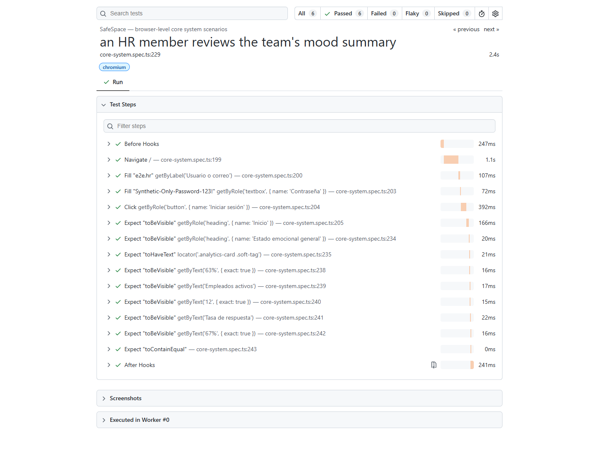

##### US09 — Respuesta única a una encuesta

**User story.** Como usuario autenticado, quiero responder una encuesta publicada una sola vez, para aportar mi opinión sin duplicar mi participación.

**Prueba ejecutada.** El empleado responde una encuesta semanal publicada y la interfaz confirma “Respuesta registrada”. La prueba verifica `POST /api/v1/surveys/11/answers` y el texto enviado. Este escenario cubre el envío exitoso de una respuesta; no ejecuta un segundo envío para comprobar el rechazo de duplicados.

**Resultado:** aprobada (1/1).

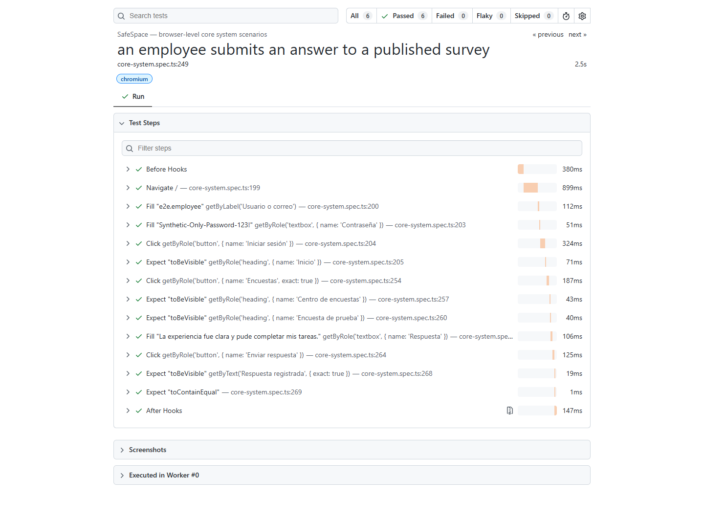

##### US10 — Gestión operativa de encuestas

**User story.** Como miembro de RR. HH. o administrador del sistema, quiero crear, consultar, publicar y cerrar encuestas, para administrar las preguntas de bienestar.

**Prueba ejecutada.** Un usuario de RR. HH. crea una encuesta semanal, verifica que aparezca como borrador y la publica; luego confirma el estado publicado. La prueba valida el payload enviado a `POST /api/v1/surveys` y la llamada a `POST /api/v1/surveys/44/publish`. Este caso cubre creación y publicación, pero no automatiza la consulta completa ni el cierre de una encuesta.

**Resultado:** aprobada (1/1).

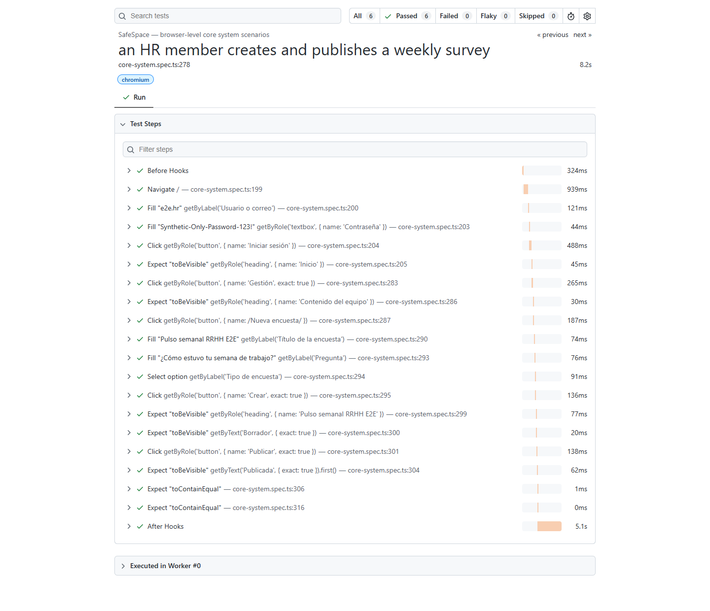

##### US15 — Votación y cambio de voto

**User story.** Como usuario autenticado, quiero votar por una opción de una actividad abierta y poder cambiar mi voto, para participar en la decisión semanal.

**Prueba ejecutada.** El empleado elige una opción de una actividad abierta y la interfaz confirma el voto. La prueba verifica `POST /api/v1/activities/22/votes` con `option_id: 31`. Este escenario cubre el registro del voto inicial; no automatiza el cambio posterior de opción.

**Resultado:** aprobada (1/1).

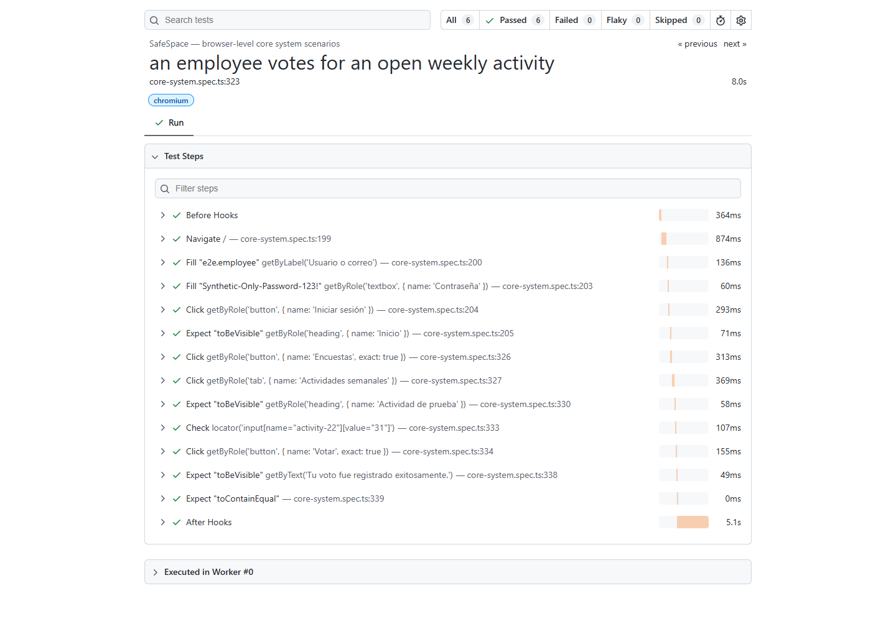

##### US17 — Creación de reportes anónimos o identificados

**User story.** Como usuario autenticado, quiero enviar un reporte con categoría, título, descripción, prioridad y opción de anonimato, para comunicar una situación que requiere atención.

**Prueba ejecutada.** El empleado completa y envía un reporte anónimo. La interfaz confirma el envío; la prueba verifica que la opción anónima esté activa y que `POST /api/v1/reports` lleve `anonymous: true`. Este escenario cubre la variante anónima y no pretende validar la consulta de reportes propios (US18).

**Resultado:** aprobada (1/1).

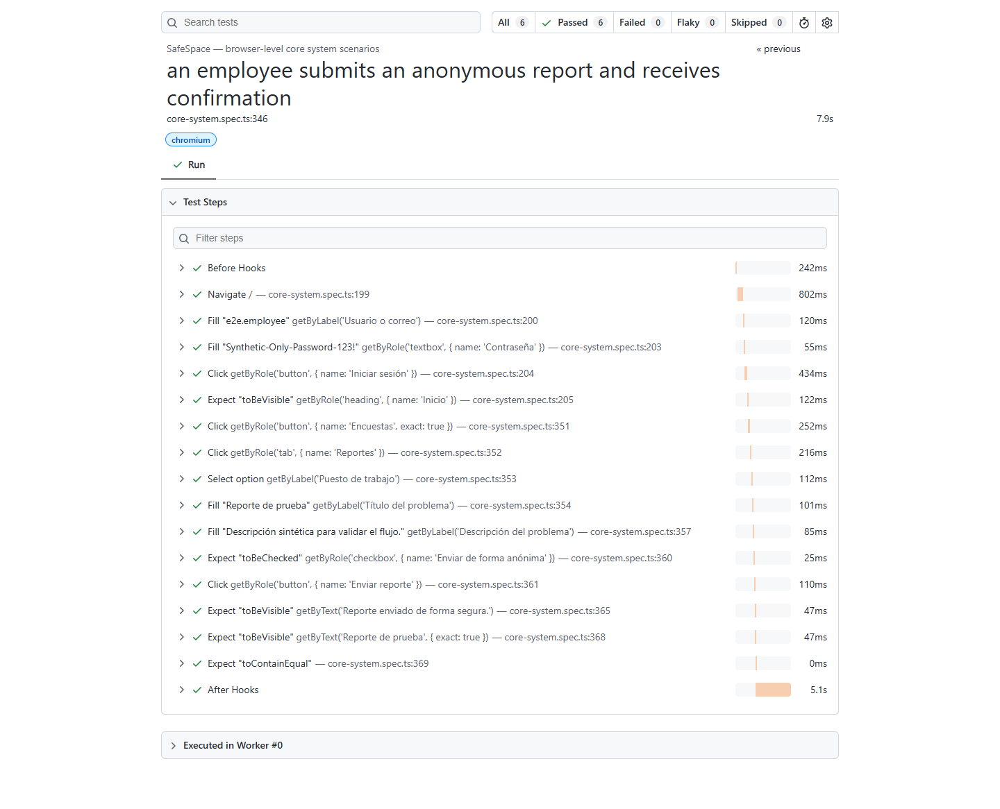

**Resultado de la ejecución.** Playwright reportó **6 pruebas aprobadas, 0 fallidas, 0 inestables y 0 omitidas**.

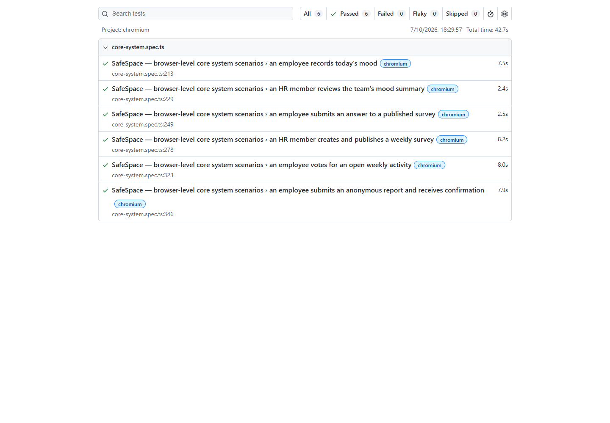

**Alcance de las pruebas.** Durante estos recorridos, Playwright intercepta las solicitudes `/api/v1/` y utiliza respuestas definidas para cada escenario. Así se validan desde el navegador la navegación, los mensajes que ve el usuario y el método, endpoint y contenido de cada solicitud. La integración y las reglas de negocio del backend se comprueban por separado en las secciones 6.1.2 y 6.1.3. Estos seis casos cubren la aplicación web; las capturas móviles del Capítulo V documentan la interfaz móvil. La suite y su configuración están en el repositorio local del frontend; todavía no se han publicado en el remoto.

#### Evidencia visual complementaria del producto web, administrativo y móvil

La siguiente matriz relaciona escenarios de aceptación con capturas de las pantallas del producto. Las imágenes documentan el estado visual de cada pantalla; la ejecución automatizada queda registrada en los reportes de Playwright anteriores.

| Caso | Escenario de aceptación | Evidencia visual |
| :--- | :--- | :--- |
| SYS-01 | Crear cuenta e iniciar sesión | `../assets/images/cap5/web/frontend-web-register.png`; `frontend-web-login.png` |
| SYS-02 | Registrar el ánimo y consultar encuestas | `../assets/images/cap5/web/frontend-web-mood.png`; `frontend-web-surveys.png` |
| SYS-03 | Votar por una actividad semanal | `../assets/images/cap5/web/frontend-web-activities.png`; `../assets/images/cap5/mobile/mobile-activity-vote.png` |
| SYS-04 | Enviar y consultar un reporte desde la experiencia web | `../assets/images/cap5/web/frontend-web-report-form.png`; `frontend-web-my-reports.png` |
| SYS-05 | Revisar encuestas, comentarios, actividades y reportes en RR. HH. | `../assets/images/cap5/web/frontend-hr-management-surveys.png`; `frontend-hr-management-comments.png`; `frontend-hr-management-activities.png`; `frontend-hr-reports.png` |
| SYS-06 | Iniciar una conversación de orientación con IA | `../assets/images/cap5/web/frontend-web-ai-chat.png`; `../assets/images/cap5/mobile/mobile-ai-chat.png` |
| SYS-07 | Consultar perfil y preferencias de cuenta | `../assets/images/cap5/web/frontend-web-settings.png`; `../assets/images/cap5/mobile/mobile-profile.png`; `mobile-settings-es.png` |
| SYS-08 | Consultar la documentación OpenAPI de SafeSpace | `../assets/images/cap5/api/swagger-ui.png`; `../assets/images/cap5/api/auth-login.png` |

Los escenarios enlazan las historias del Capítulo III con las funciones mostradas en el Capítulo V. La suite automatizada aporta cobertura de reglas de negocio, mientras que las capturas sirven como evidencia complementaria de las interfaces.

## 6.2. Static Testing & Verification

Esta sección distingue las comprobaciones estáticas configuradas en los repositorios de los resultados ejecutados para esta revisión. Los comandos y resultados se indican por separado para no confundir disponibilidad de una herramienta con ejecución efectiva.

### 6.2.1. Static Code Analysis

#### 6.2.1.1. Coding Standards and Conventions

En el frontend web, `package.json` define los comandos `typecheck` (TypeScript), `lint` (oxlint) y `format:check` (Prettier) para revisar tipos, patrones de código y formato. En el backend se mantiene el workflow de Maven para ejecutar pruebas, pero en la configuración revisada no se identificó un analizador estático dedicado equivalente a Checkstyle, SpotBugs, PMD o Sonar. Las pruebas de Maven no se presentan como análisis estático.

| Componente | Herramienta o práctica identificada | Evidencia de configuración | Resultado de una corrida para este informe |
| :--- | :--- | :--- | :--- |
| Frontend web | TypeScript (`npm run typecheck`) | Script definido en `package.json` | Aprobado; sin errores de tipo. |
| Frontend web | oxlint (`npm run lint`) | Script definido en `package.json` | Aprobado; sin hallazgos de lint. |
| Frontend web | Prettier (`npm run format:check`) | Script definido en `package.json` | 37 archivos requieren ajuste de formato; no se modificaron durante esta revisión. |
| Backend | Apache Spotless 2.44.4 con Google Java Format AOSP 1.24.0 | Plugin configurado en `pom.xml` | `spotless:check` en Java 21: 172 archivos limpios; 1 archivo requiere ajuste de formato (`AuthServiceTest.java`). |

La corrida del backend se realizó sobre la copia local conectada al repositorio, con Java 21 y Maven 3.9.11. El control de Spotless detectó diferencias de formato de fin de línea en el archivo indicado; no se modificó durante esta revisión para conservar los cambios de trabajo existentes. La integración continua del backend ejecuta pruebas, pero el workflow no contiene una herramienta de análisis estático dedicada como SpotBugs, PMD o Sonar.

#### 6.2.1.2. Software Quality and Security

La revisión manual de seguridad examinó autenticación, autorización, configuración de secretos, CORS y el tratamiento de los reportes en el código del backend. No se encontró configurado un escáner SAST ni un análisis de dependencias con base de vulnerabilidades; por eso, esta revisión no certifica la ausencia de vulnerabilidades en bibliotecas transitivas.

| ID / severidad | Hallazgo y evidencia | Impacto y acción recomendada |
| :--- | :--- | :--- |
| SEC-01 / Alto | El modelo `Report` conserva una referencia al usuario incluso cuando `anonymous` es `true`. El adaptador de Firestore serializa un snapshot de la entidad relacionada; `ReportService` oculta `reporterDisplayName` en la respuesta HTTP, pero la identidad permanece asociada al documento almacenado. | La opción anónima oculta el nombre en la respuesta de la API, pero no elimina la asociación en Firestore. Revisar el modelo para que el almacenamiento no incluya identidad en reportes anónimos y añadir una prueba del documento persistido antes de describirlos como anónimos frente a quienes administran la base de datos. |
| SEC-02 / Medio | `application.yml` contiene una clave JWT conocida como valor de respaldo. Render declara `JWT_SECRET` generado para el servicio de producción, pero otros entornos podrían arrancar con la clave de desarrollo si no la reemplazan. | Mantener la clave local solo para desarrollo y exigir un secreto configurado fuera del perfil local; comprobar longitud y rotación en el proveedor. |

También se observaron controles favorables: contraseñas codificadas con BCrypt; API stateless con JWT; restricciones por rol en rutas administrativas y de orientación; lista explícita de orígenes CORS configurada por entorno; y la credencial de Firebase montada como secreto del servicio, no embebida en `render.yaml`. La presencia de estas medidas no sustituye el escaneo de dependencias ni las pruebas de privacidad del almacenamiento.

### 6.2.2. Reviews

La revisión por pares debe verificar la correspondencia entre el cambio, la historia de usuario y sus criterios de aceptación; legibilidad y mantenibilidad; pruebas pertinentes; autorización y privacidad; y efectos en la documentación o despliegue. La revisión se registra únicamente cuando exista una pull request o revisión verificable.

| Cambio o pull request | Revisor | Criterios revisados | Hallazgos y resolución | Evidencia |
| :--- | :--- | :--- | :--- | :--- |
| Revisión estática y manual del backend conectado | Revisión técnica para esta entrega | Formato, ejecución de pruebas, JWT, roles, CORS, variables de entorno y serialización de reportes | 967 pruebas aprobadas; Spotless encontró 1 archivo con formato por ajustar; se registraron SEC-01 y SEC-02 arriba. | `mvn -B test`; `mvn spotless:check`; código local y `render.yaml` |

No se atribuyen revisiones ni aprobaciones individuales sin su registro correspondiente.

## 6.3. Validation Interviews

Las entrevistas de validación buscan conocer cómo personas de los dos segmentos entienden SafeSpace y sus flujos. Las preguntas de esta sección constituyen una guía para obtener respuestas individuales. Las seis sesiones presenciales de uso que ya se realizaron se resumen en 6.3.2; como no se conservaron transcripciones ni notas pregunta por pregunta, no se afirma que esta guía se haya aplicado literalmente ni se atribuyen respuestas a participantes concretos.

### 6.3.1. Interview Design

#### Propósito y protocolo común

La guía se centra en la comprensión del anonimato y el envío de reportes para empleados, y en la lectura del resumen y el seguimiento para Recursos Humanos. También propone explorar facilidad, claridad, confianza y puntos de fricción en los flujos web o móviles.

Antes de iniciar, el moderador explicará que se evalúa el producto, no a la persona; que puede omitir cualquier pregunta o detener la sesión; que se usarán cuentas y datos ficticios; y que no se deben compartir incidentes laborales reales ni información sensible. Las notas se identificarán con un código y se evitarán nombres de personas, empresas, correos y detalles que permitan reconocer un caso. La grabación de audio o video requerirá autorización separada y explícita; si no se obtiene, se tomarán notas sin grabar.

**Introducción sugerida:** «Gracias por participar. Queremos observar cómo se entienden algunas funciones de SafeSpace. No estamos evaluándote a ti; nos interesa saber qué resulta claro o confuso. Usaremos información ficticia. Puedes saltarte una pregunta o terminar cuando quieras. ¿Tienes alguna duda antes de empezar? ¿Aceptas participar? ¿Aceptas por separado que grabemos la sesión?»

Para una ronda de entrevistas con registro individual, el equipo definirá participantes, criterios de reclutamiento, modalidad y persona moderadora antes de convocar. Esta planificación no sustituye el resumen de las sesiones ya realizadas ni les atribuye preguntas que no quedaron registradas.

#### Segmento 1: empleados de una organización

**Preguntas de introducción**

1. Sin mencionar la empresa ni nombres, ¿qué tipo de trabajo realizas y qué herramientas digitales utilizas normalmente durante la jornada?
2. Cuando una organización quiere conocer cómo se sienten sus colaboradores, ¿qué medios suelen utilizarse? Puedes responder en términos generales.
3. ¿Qué esperarías que ocurra después de compartir una opinión o enviar un reporte a un canal interno?
4. ¿Qué información necesitarías para decidir si un canal digital es suficientemente privado y confiable?

**Tareas con cuenta y datos de prueba**

1. Registra un estado de ánimo del día y explica qué confirmación esperas ver.
2. Responde una encuesta publicada o participa en una actividad abierta.
3. Envía un reporte ficticio y elige la opción anónima. Antes de enviarlo, explica qué entiendes que verá Recursos Humanos y qué datos crees que quedarán asociados a tu cuenta.
4. Si el flujo está disponible, inicia una consulta de orientación con un ejemplo neutral y no personal.

**Preguntas posteriores y sondeos**

- ¿Qué te resultó más claro y qué tuviste que interpretar por tu cuenta?
- ¿En qué momento dudaste o buscaste ayuda? ¿Qué esperabas que pasara?
- Después de revisar la pantalla, ¿cómo explicarías con tus propias palabras qué significa «anónimo» en este flujo? ¿Qué señal te permitiría confiar más?
- ¿Qué confirmación o seguimiento esperarías luego de enviar el reporte?
- En una escala de 1 a 5, ¿qué tan fácil fue completar la tarea? ¿Qué explica tu calificación?
- En una escala de 1 a 5, ¿qué tanta confianza te dio el flujo respecto a la privacidad? ¿Qué cambiaría esa respuesta?
- ¿En qué contexto usarías esta función y qué podría impedirte usarla?

#### Segmento 2: profesionales de Recursos Humanos

**Preguntas de introducción**

1. Sin indicar el nombre de la organización, ¿qué responsabilidades generales tienes relacionadas con bienestar, clima laboral o comunicación interna?
2. ¿Qué tipos de información suelen revisar para decidir si es necesario dar seguimiento a una situación?
3. En términos generales, ¿cómo se organiza actualmente el seguimiento de comentarios, encuestas o reportes?
4. ¿Qué información considerarías necesaria para interpretar un indicador de participación o estado de ánimo?

**Tareas con cuenta y datos de prueba**

1. Revisa el resumen de ánimo y describe qué conclusiones permitirían y cuáles no permitirían esos datos.
2. Crea una encuesta de prueba en borrador y publícala si el entorno de validación lo permite.
3. Abre un reporte ficticio y cambia su estado siguiendo el flujo disponible.

**Preguntas posteriores y sondeos**

- ¿Qué decisión podrías tomar a partir del resumen y qué dato adicional necesitarías?
- ¿Cómo interpretas el periodo, el número de respuestas y la tasa de participación? ¿Qué ambigüedad encontraste?
- ¿Qué pasos o trabajo manual esperabas realizar antes de completar la tarea?
- ¿Qué controles de acceso o privacidad esperarías al consultar reportes y resúmenes?
- En una escala de 1 a 5, ¿qué tan fácil fue completar la tarea? ¿Qué explica tu calificación?
- En una escala de 1 a 5, ¿qué tan útil te resultó la información para decidir un siguiente paso? ¿Qué faltó?
- ¿Qué cambio sería más importante antes de utilizar esta vista en un proceso real?

**Cierre común:** «¿Qué no te pregunté y debería considerar? Si pudieras cambiar una sola cosa de lo que acabas de usar, ¿cuál sería?» Las respuestas de intención o utilidad percibida se reportarán como opinión declarada, no como adopción real ni mejora demostrada del proceso.

#### Registro de observación

Para cada tarea se anotará si se completó sin ayuda, con ayuda o no se completó; duración aproximada; errores, retrocesos y dudas observables; comentarios textuales anonimizados; y valoración del participante. Se registrará el dispositivo/plataforma (web o Android) y la versión usada. Las tareas deben realizarse con datos sintéticos y el moderador no debe sugerir una respuesta esperada.

### 6.3.2. Interview Records and Validation Session Summary

#### Segmento 1: empleados de una organización

##### Entrevista individual a un empleado — 08/11/2026

- **Modalidad:** Entrevista remota por Discord con demostración de los flujos web de SafeSpace.
- **Duración:** 11:44.

**Resumen de la Entrevista**

El resumen recibido indica que la persona entrevistada usa herramientas digitales para organizar tareas y coordinar trabajo, y valora que las encuestas sean breves, claras y expliquen el uso de las respuestas. En la demostración identificó las confirmaciones del registro de ánimo, la respuesta a una encuesta y el voto en una actividad semanal; señaló el registro de ánimo como el flujo más fácil de comprender. En el reporte, la etiqueta «Puesto de trabajo» le resultó ambigua y pidió mayor claridad sobre el anonimato, los datos asociados a la cuenta y quién puede consultar la información. También expresó que esperaba consultar el estado del reporte y recibir información cuando avance su atención. Consideró que la orientación puede ayudar a ordenar ideas y calificó la facilidad con 5/5 y la confianza en la privacidad con 4/5. Estas observaciones se presentan como resumen parafraseado, no como citas textuales.

No se incluye una captura de la videollamada ni un enlace audiovisual en esta versión, porque el registro disponible no documenta autorización para publicar imágenes identificables.
#### Resumen agregado de las seis sesiones presenciales

Se realizaron sesiones presenciales de validación basadas en tareas con tres empleados el 06/11/2026 y tres profesionales de Recursos Humanos el 05/11/2026. Para estas seis sesiones no se conservaron transcripciones ni un registro de las preguntas realizadas; el resumen agregado no permite atribuir cada tarea, observación o frase a una persona específica. Por ello no se incluyen citas textuales ni se reconstruyen respuestas individuales.

| Segmento | Participantes | Fecha/modalidad | Flujos probados según el resumen del equipo |
| :--- | :---: | :--- | :--- |
| Empleados | 3 | 06/11/2026, presencial | Encuestas, chat con IA, responder comentarios y reportes. No se especificó si los reportes fueron anónimos o identificados. |
| Recursos Humanos | 3 | 05/11/2026, presencial | Crear encuestas, crear encuestas para actividades semanales, revisar el análisis de ánimo y consultar reportes de empleados. |

**Dispositivo y versión:** los tres empleados utilizaron PC. En Recursos Humanos, dos participantes utilizaron un dispositivo móvil y uno utilizó PC. El equipo indicó que todos probaron la última versión disponible de la aplicación; no se proporcionó un número de versión.

**Datos de las sesiones:** se creó una cuenta por participante con datos que cada persona proporcionó y con su consentimiento para participar. Cada participante siguió el flujo de su segmento. La sesión duró aproximadamente entre 10 y 15 minutos; no se dispone de duración desglosada por tarea. No se reportaron errores. La única duda recordada fue cómo realizar un reporte, y se resolvió sin ayuda; los seis completaron el flujo esperado sin asistencia del moderador. Para proteger la privacidad, no se incluyen datos identificables de las cuentas. A diferencia de estas sesiones, las próximas pruebas deben usar cuentas y datos sintéticos, conforme al protocolo.

**Resultado agregado reportado por el equipo:** los tres participantes de cada segmento calificaron la facilidad de uso con 5/5 y la valoración general fue positiva. Un empleado describió SafeSpace como creativa y como una solución esperada en las empresas; se registra como paráfrasis, no como cita textual. Estos resultados describen esta muestra, no prueban adopción ni satisfacción de toda la población.

No se mostraron otros prototipos ni se compararon variantes, por lo que estas sesiones se registran como validación formativa de la última versión disponible y no como experimento controlado. El equipo confirmó el consentimiento para participar. No cuenta con autorización para publicar fotografías de los participantes; por ello no se incluirán imágenes de estas sesiones.

No se conservó una ficha individual para estas seis sesiones. Se reportan únicamente los datos agregados anteriores; las próximas sesiones se documentarán con códigos no identificables, resultados por tarea y evidencia cuyo uso esté autorizado.

### 6.3.3. Heuristic Evaluations

La evaluación heurística complementará las entrevistas mediante una revisión estructurada de los flujos de registro de ánimo, participación, reporte anónimo y gestión de RR. HH. Cada evaluador registrará pantalla, dispositivo, paso, problema observado, principio afectado, severidad de 0 a 4 y recomendación. La severidad y los hallazgos quedan pendientes de revisión real.

| Principio de revisión | Pregunta de evaluación |
| :--- | :--- |
| Visibilidad del estado | ¿La interfaz confirma el envío, guardado, publicación o cambio de estado? |
| Correspondencia con el lenguaje del usuario | ¿Las etiquetas y estados se entienden sin conocer términos internos del sistema? |
| Reconocimiento y claridad | ¿Las acciones, opciones y requisitos están visibles cuando se necesitan? |
| Control y reversibilidad | ¿Se puede corregir o cancelar una acción antes de que tenga consecuencias? |
| Prevención y recuperación de errores | ¿Se explican los errores y el camino para resolverlos sin perder información? |
| Privacidad y confianza | ¿La interfaz explica qué se comparte y con quién, especialmente al elegir anonimato? |

| Evaluador/fecha | Flujo y pantalla | Problema y principio | Severidad (0–4) | Recomendación/estado |
| :--- | :--- | :--- | :--- | :--- |
| [Pendiente] | [Pendiente] | [Pendiente] | [Pendiente] | [Pendiente] |

## 6.4. UX Audits

Según la indicación del profesor, el intercambio de auditorías UX se realizará en clase. Comprende la **auditoría realizada**, en la que el equipo SafeSpace evalúa la experiencia de otro grupo, y la **auditoría recibida**, en la que otro equipo evalúa SafeSpace. A la fecha de esta versión, las actividades no se han realizado; por ello, el registro siguiente identifica la información que se recogerá en clase y no anticipa hallazgos ni respuestas.

### 6.4.1. Auditoría realizada

#### 6.4.1.1. Información del grupo auditado

| Campo | Registro previsto para la sesión en clase |
| :--- | :--- |
| Grupo auditado e integrantes | Se consignarán durante la actividad. |
| Producto, versión y plataforma auditados | Se registrarán durante la actividad. |

#### 6.4.1.2. Cronograma de auditoría realizada

| Campo | Registro previsto para la sesión en clase |
| :--- | :--- |
| Fecha y duración | La fecha se definirá en clase y se anotará junto con la duración. |

#### 6.4.1.3. Contenido de auditoría realizada

| Campo | Registro previsto para la sesión en clase |
| :--- | :--- |
| Flujos incluidos | Se anotarán según las tareas evaluadas. |
| Método y criterios | Lista heurística de 6.3.3 y tareas de validación de 6.3.1 |
| Hallazgos y severidad | Se documentarán a partir de observaciones reales durante la sesión. |
| Evidencia | Se referenciará el acta, las capturas autorizadas o el backlog resultante. |

### 6.4.2. Auditoría recibida

#### 6.4.2.1. Información del grupo auditor

| Campo | Registro previsto para la sesión en clase |
| :--- | :--- |
| Equipo que realizó la revisión | Se consignará durante la actividad. |
| Integrantes/contacto académico | Se registrarán con el alcance autorizado. |

#### 6.4.2.2. Cronograma de auditoría recibida

| Campo | Registro previsto para la sesión en clase |
| :--- | :--- |
| Fecha y modalidad | Se registrarán durante la actividad en clase. |

#### 6.4.2.3. Contenido de auditoría recibida

| Campo | Registro previsto para la sesión en clase |
| :--- | :--- |
| Material y versión revisados | Se anotarán durante la actividad. |
| Comentarios recibidos | Se resumirán conservando el sentido de las observaciones. |
| Respuesta del equipo SafeSpace | Se registrará la decisión acordada para cada hallazgo. |
| Evidencia | Se vinculará el acta o registro de intercambio. |

#### 6.4.2.4. Resumen de modificaciones para subsanar hallazgos

Después del intercambio en clase, se consolidarán los hallazgos repetidos y se priorizarán por impacto en la tarea, privacidad y frecuencia observada. Para cada hallazgo se documentará la decisión acordada, el responsable si se asigna y el enlace a la evidencia, como un issue o un commit. No se anticipan modificaciones antes de recibir las observaciones.

| Hallazgo | Decisión o acción acordada | Estado tras la revisión | Evidencia |
| :--- | :--- | :--- | :--- |
| Se completará con los hallazgos de la auditoría recibida en clase. | Se registrará según el acuerdo del equipo. | Se actualizará después de la revisión. | Se agregará el enlace a la evidencia disponible. |

\newpage
