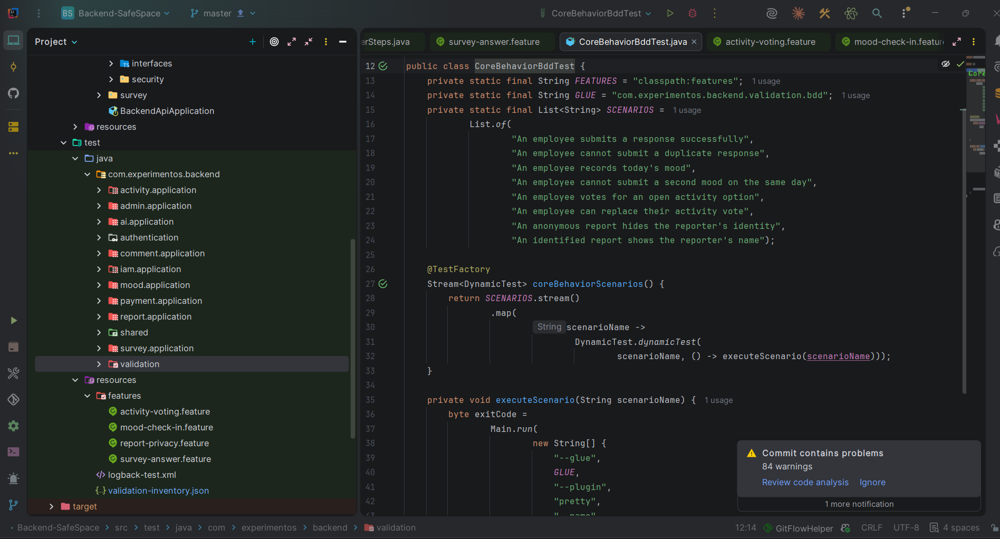
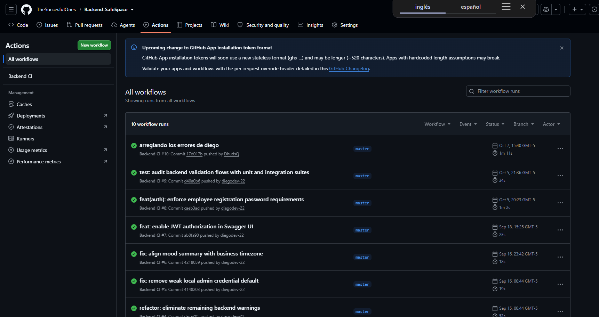
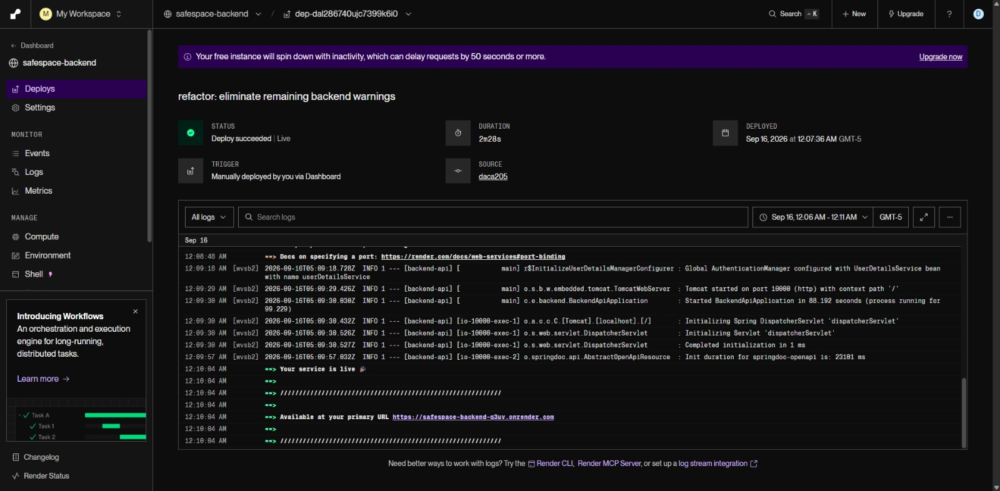
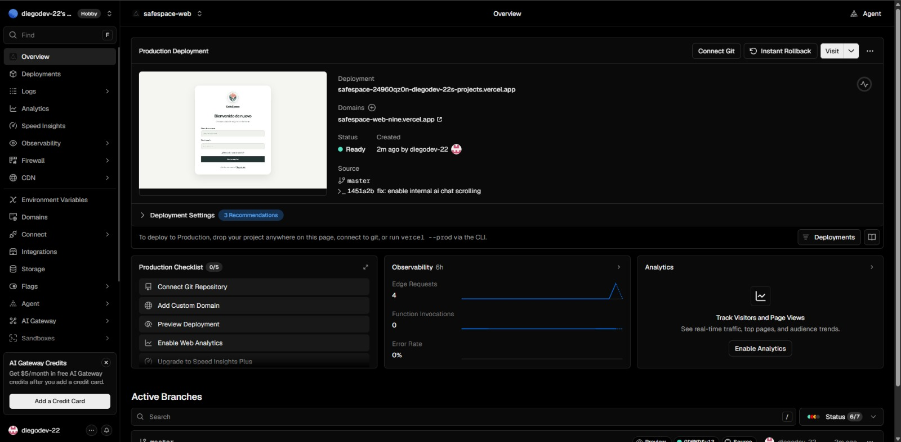
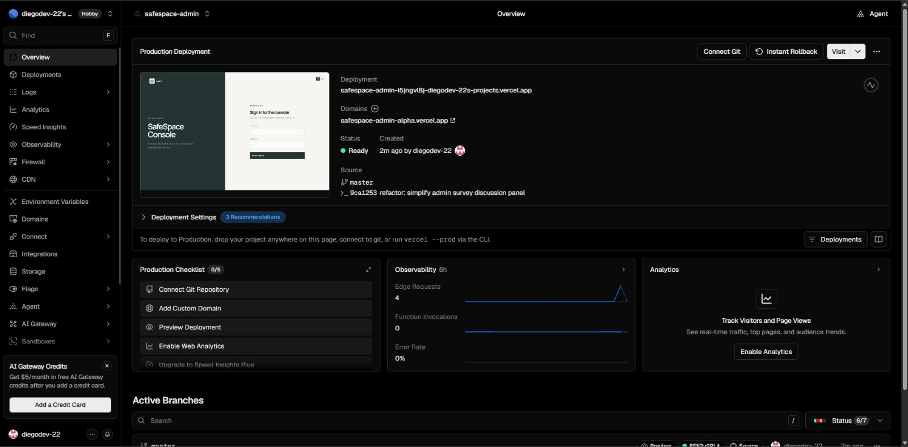
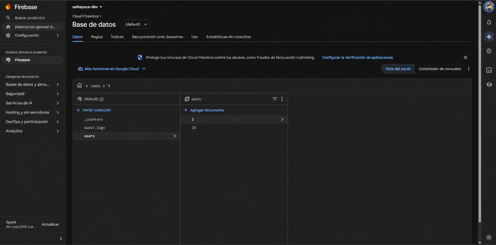

# Capítulo VII: DevOps Practices

Este capítulo presenta las herramientas y etapas que participan en la integración, las pruebas y la publicación de SafeSpace. El backend usa Firebase Firestore como base de datos en tiempo de ejecución. Los símbolos de marca se presentan en imágenes individuales y provienen de [Simple Icons](https://github.com/simple-icons/simple-icons), un proyecto publicado bajo licencia CC0-1.0.

## 7.1. Continuous Integration

### 7.1.1. Tools and Practices

El repositorio [Backend-SafeSpace](https://github.com/TheSuccesfulOnes/Backend-SafeSpace) contiene el workflow `Backend CI`, definido en `.github/workflows/ci.yml`. GitHub Actions lo ejecuta cuando hay un `push` o un `pull_request` hacia `master`; el job prepara Temurin JDK 21 y Maven, y ejecuta `mvn -B test`.

El backend combina pruebas unitarias con escenarios BDD. En el frontend web, `package.json` incluye scripts de Vitest y Playwright, además de comandos para revisar tipos, lint y compilar. Esos comandos están disponibles para ejecución local; no se encontró un workflow de CI en el repositorio del frontend.

| Herramienta | Tipo | Descripción | Propósito |
| :--- | :--- | :--- | :--- |
| GitHub Actions | Plataforma de integración continua | Ejecuta `Backend CI` ante `push` o `pull_request` dirigidos a `master`. | Asociar las verificaciones del backend con cada cambio recibido. |
| Maven | Construcción y ejecución de pruebas | El workflow ejecuta `mvn -B test` con Java 21 y Temurin. | Compilar el backend y ejecutar sus pruebas automatizadas. |
| JUnit 5 | Framework de pruebas | Ejecuta las pruebas Java y los escenarios BDD expuestos como pruebas dinámicas. | Verificar el comportamiento de unidades y servicios del backend. |
| Mockito | Framework de dobles de prueba | Permite sustituir dependencias durante las pruebas Java. | Aislar el componente que se está verificando. |
| Cucumber | Framework BDD | Ejecuta escenarios descritos en Gherkin con Cucumber JVM y JUnit 5. | Comprobar comportamientos mediante ejemplos legibles. |
| Vitest | Framework de pruebas del frontend | Está disponible mediante el script `test:validation` de `package.json`. | Ejecutar pruebas de validación de la aplicación web. |
| Playwright | Framework de pruebas End-to-End | Está disponible mediante el script `test:e2e` de `package.json`. | Verificar recorridos de usuario en el navegador. |

El backend mantiene cuatro archivos `.feature`. La captura de IntelliJ IDEA permite ver `CoreBehaviorBddTest` y esos escenarios; muestra la organización del código de prueba, no el resultado de una ejecución.

### 7.1.2. Build & Test Suite Pipeline Components

**Integración continua del backend:** el workflow descarga la revisión con `actions/checkout@v4`, prepara Ubuntu y Temurin JDK 21 con `actions/setup-java@v4`, y habilita la caché de Maven. Después ejecuta `mvn -B test`; GitHub Actions publica el resultado del job asociado al commit.

**Pruebas del frontend:** los scripts locales permiten ejecutar Vitest, Playwright, typecheck, lint y build. Al no encontrarse un workflow en el repositorio web, estas comprobaciones no se ejecutan automáticamente por cada `push` o `pull_request`.

**Alcance del pipeline:** el workflow `Backend CI` termina al finalizar las pruebas. No construye ni publica una versión en Render, y tampoco coordina el despliegue de Vercel.

{.inline width=100%}

**IntelliJ IDEA.** La captura muestra la clase `CoreBehaviorBddTest` y los archivos `.feature` de los escenarios BDD. IntelliJ es el entorno donde se organizan y editan estas pruebas; la imagen documenta su estructura, no el resultado de una ejecución.

{.inline width=100%}

**GitHub Actions.** El workflow `Backend CI` automatiza la validación del backend para cambios dirigidos a `master`: prepara Java 21 y Maven y ejecuta `mvn -B test`. En la captura se ven varias ejecuciones recientes con estado exitoso; el workflow no publica por sí mismo el backend.

## 7.2. Continuous Delivery

La entrega continua busca mantener una versión probada en condiciones de ser publicada. En SafeSpace, la validación automática está configurada para el backend; la publicación de la API y de las interfaces se gestiona en sus respectivos proveedores.

### 7.2.1. Tools and Practices

**Tools:**

**GitHub Actions y Maven:** el workflow del backend ejecuta las pruebas en cambios hacia `master`. La definición de CI no incluye la publicación del servicio.

**Docker:** el `Dockerfile` construye un JAR con Maven y prepara una imagen de ejecución con Java 21. Las pruebas se ejecutan aparte en GitHub Actions; la construcción de la imagen usa `-DskipTests`.

**Render:** aloja la API REST. `render.yaml` define el runtime Docker, la rama `master`, el perfil `prod`, el puerto 10000 y la ruta de health check `/v3/api-docs`. La captura de despliegue disponible indica que esa publicación se inició manualmente desde el dashboard.

**Vercel:** el equipo confirmó despliegue automático de las aplicaciones web al recibir cambios en la rama Git conectada.

**Firebase Firestore:** es la base de datos administrada que consulta el backend en ejecución. El servicio se configura con los parámetros de Firebase y las credenciales del entorno; no utiliza migraciones de MySQL o Flyway.

**Gradle:** construye el APK de Android, que se distribuye por separado de la API y de las aplicaciones web. El equipo informa que el APK se descarga e instala manualmente; no se identificó una publicación móvil automatizada.

**Practices (Prácticas)**

**Validación antes de publicar:** las pruebas del backend se ejecutan en CI. Para el frontend existen scripts de prueba y compilación, aunque no se encontró una ejecución automática mediante workflow.

**Promoción a producción:** Vercel publica automáticamente los cambios de la rama Git conectada para las aplicaciones web. La captura de Render registra una publicación manual de la API. La automatización web no se presenta como condicionada por el resultado de CI del backend.

**Configuración por entorno:** Firestore y los servicios se conectan mediante parámetros y credenciales configurados en el proveedor, separados del código fuente.

**Verificación de la versión:** el estado Ready de Vercel y el estado de servicio de Render permiten revisar la publicación en sus dashboards. Esos estados no sustituyen una prueba funcional de los recorridos de la aplicación.

{.inline width=100%}

**Render.** Render aloja la API REST del proyecto. La captura registra un despliegue completado y el servicio en estado Live; también indica que esa activación se inició manualmente desde el dashboard y muestra los logs de arranque.

{.inline width=100%}

**Vercel — proyecto web.** La captura muestra `safespace-web`, su dominio y una publicación en estado Ready. El equipo confirmó que Vercel publica automáticamente las aplicaciones web al recibir cambios en la rama Git conectada.

{.inline width=100%}

**Vercel — proyecto administrativo.** La captura muestra `safespace-admin`, su dominio y una publicación en estado Ready. El equipo confirmó que la aplicación web se despliega automáticamente mediante Vercel desde la rama Git conectada.

### 7.2.2. Stages Deployment Pipeline Components

**Integración continua (CI):** al recibir cambios en el backend, GitHub Actions prepara el entorno Java y ejecuta Maven. El frontend cuenta con scripts locales de validación, pero no con un workflow automático identificado.

**Validación en staging:** no se identificó un entorno de staging ni una etapa de promoción entre ambientes en la configuración revisada. Las versiones Ready de Vercel y el servicio de Render corresponden a publicaciones de los proveedores.

**Construcción y despliegue del backend:** el `Dockerfile` empaqueta la aplicación para ejecución con Java 21. Render aloja el servicio y declara la configuración de producción en `render.yaml`; la captura disponible registra una activación manual.

**Publicación de las interfaces web:** Vercel publica automáticamente la landing, la aplicación web y la consola administrativa desde sus repositorios conectados. El equipo identificó esta automatización en la plataforma.

**Monitoreo y feedback:** Render tiene configurada la ruta `/v3/api-docs` como health check del servicio. No se encontró una prueba smoke automatizada que valide después de publicar los flujos funcionales de SafeSpace.

**Aprobación y reversión:** la publicación de Render observada fue iniciada manualmente. En las capturas de Vercel aparece una opción de reversión instantánea; no se muestra una reversión ejecutada ni una aprobación formal en el pipeline.

## 7.3. Continuous Deployment

El despliegue continuo lleva a producción los cambios recibidos por la rama Git conectada. En SafeSpace, Vercel publica automáticamente las aplicaciones web. La API se aloja en Render y la captura disponible registra una activación manual; el workflow de GitHub Actions ejecuta pruebas del backend y se documenta por separado del despliegue.

### 7.3.1. Tools and Practices

En este apartado se describen las herramientas que intervienen en la publicación y las prácticas que permitirían automatizarla de forma controlada.

**Tools (Herramientas)**

- **GitHub Actions y Maven:** validan los cambios del backend con `mvn -B test`. Para utilizarlos como condición de publicación, el despliegue tendría que depender del resultado exitoso del job.
- **Docker y Render:** Docker construye la imagen de la API y Render la aloja. La publicación observada se inició manualmente; no se presenta como despliegue continuo.
- **Vercel:** aloja las aplicaciones web y la consola administrativa, y publica automáticamente desde la rama Git conectada.
- **Firebase Firestore:** es el servicio de datos usado por el backend. Las credenciales deben permanecer configuradas en el entorno protegido del proveedor.
- **Vitest y Playwright:** los scripts del frontend permiten ejecutar pruebas de validación y End-to-End. Para que sean una puerta de calidad, primero deben incorporarse a un workflow de CI.
- **Gradle:** construye el APK de Android; su publicación permanece separada del flujo de las aplicaciones web y el backend.

**Practices (Prácticas)**

**Despliegue basado en cambios validados:** usar el commit integrado como referencia del artefacto y habilitar la publicación únicamente después de las comprobaciones correspondientes.

**Automatización por componente:** mantener separada la CI del backend y la publicación automática del frontend en Vercel; incorporar las validaciones del frontend al flujo de CI y hacer visible su resultado junto a la publicación.

**Comprobación posterior:** verificar la disponibilidad del servicio y una operación esencial tras cada publicación. El health check configurado en Render comprueba la ruta declarada, pero no reemplaza estas verificaciones funcionales.

**Recuperación:** conservar una versión anterior identificable y documentar el procedimiento de reversión. La presencia de un control en el dashboard no demuestra que una reversión automática esté configurada.

Vercel automatiza la publicación web desde la rama Git conectada. El workflow de backend ejecuta las pruebas, mientras que la publicación de Render observada fue manual; cada flujo se describe de acuerdo con su configuración y evidencia disponible.

### 7.3.2. Production Deployment Pipeline Components

Este apartado detalla los componentes de datos, backend, frontend y Android. En cada uno se describe el flujo que se observa y la etapa que aún requiere automatización.

**Componentes del pipeline de datos (Firebase Firestore)**

Firestore es un servicio administrado y se consulta en tiempo de ejecución desde el backend. La aplicación recibe la configuración y las credenciales desde el entorno de producción; no hay una etapa de migración SQL en el pipeline. La configuración de Render declara `/v3/api-docs` como health check de la API, pero esa ruta no acredita por sí sola que las operaciones sobre Firestore funcionen después de un despliegue.

{.inline width=100%}

**Cloud Firestore.** Firestore es la base de datos documental administrada que consulta el backend en ejecución. La captura muestra las colecciones `_counters`, `audit_logs` y `users`; el panel de detalle se ocultó para no publicar datos del administrador. La imagen acredita la consola y las colecciones visibles, no una prueba de lectura o escritura desde la aplicación.

{.inline width=85%}

**Firebase Firestore.** Firebase proporciona el servicio administrado de datos utilizado por SafeSpace. El backend obtiene la configuración desde el entorno y accede a Firestore durante la ejecución; no se emplean migraciones MySQL o Flyway.

**Componentes del pipeline del backend (GitHub Actions, Docker y Render)**

1. **Integración continua:** un `push` o `pull_request` hacia `master` inicia `Backend CI`, que ejecuta las pruebas Maven con Java 21.
2. **Construcción:** el `Dockerfile` empaqueta el JAR con `-DskipTests` y crea la imagen de ejecución basada en Java 21. Las pruebas se realizan en el job de CI.
3. **Configuración de producción:** `render.yaml` define el servicio Docker, la rama `master`, el perfil `prod`, el puerto y el health check `/v3/api-docs`.
4. **Despliegue:** Render aloja la API. La captura revisada identifica la activación manual de la publicación observada.
5. **Verificación:** el proveedor consulta la ruta de salud configurada. La canalización no muestra un smoke test funcional ni una reversión automática asociados al resultado.

{.inline width=85%}

**GitHub Actions.** Ejecuta el workflow `Backend CI` cuando hay cambios dirigidos a `master`. El flujo configura Java 21, prepara Maven y publica el resultado de las pruebas asociadas al commit; no incluye un paso de despliegue.

{.inline width=85%}

**Apache Maven.** Maven construye y ejecuta las pruebas del backend. En la integración continua se invoca con `mvn -B test` bajo Temurin JDK 21.

{.inline width=85%}

**Docker.** Docker empaqueta el backend para ejecutarlo como servicio. El `Dockerfile` construye el JAR y define una imagen de ejecución con Java 21; omite las pruebas en esa etapa porque estas corren previamente en GitHub Actions.

{.inline width=85%}

**Render.** Render aloja la API en producción. `render.yaml` define el runtime Docker, la rama `master`, el perfil `prod`, el puerto 10000 y la ruta `/v3/api-docs` para el health check; la publicación observada se inició manualmente.

**Componentes del pipeline del frontend (Vercel)**

1. **Validación local:** `package.json` incluye scripts para Vitest, Playwright, typecheck, lint y build.
2. **Integración continua:** no se identificó un workflow que ejecute esas verificaciones automáticamente en el repositorio web.
3. **Publicación:** Vercel publica automáticamente las aplicaciones web al recibir cambios en la rama Git conectada.
4. **Mejora propuesta:** incorporar las verificaciones del frontend al flujo de CI y decidir si la publicación debe esperar a que terminen con resultado aprobado.

{.inline width=85%}

**Vercel.** La plataforma aloja los proyectos web y administrativo y publica automáticamente los cambios recibidos por la rama Git conectada; las capturas muestran versiones en estado Ready.

**Componentes del pipeline de Android (Gradle)**

Gradle construye el APK que se distribuye por separado. El equipo informa que la descarga e instalación se hacen manualmente; no se identificó un workflow que ejecute pruebas y publique el artefacto móvil automáticamente ni una integración de ese proceso con los despliegues de la API y las interfaces web.

{.inline width=85%}

**Gradle.** Gradle construye el APK de Android para su distribución. El equipo indica que la descarga e instalación se hacen manualmente. El proceso móvil permanece separado de los despliegues del backend y de las interfaces web; no se identificó una publicación móvil automatizada.

SafeSpace cuenta con CI del backend en GitHub Actions, despliegue automático del frontend en Vercel y publicación de la API en Render, cuya captura registra una activación manual. Android se distribuye mediante APK descargable. La lentitud de los despliegues mencionada en el Shareback se atribuyó al uso de servicios gratuitos; por ello, la sección de experimentación propone registrar tiempos por proveedor y componente antes de decidir cambios de plan.

## 7.4. Continuous Monitoring

La monitorización continua reúne señales de disponibilidad, errores y comportamiento de los servicios después de desplegar una versión. En SafeSpace se identifican los paneles de despliegue y logs de Render y los paneles de observabilidad de Vercel; estos servicios también forman parte del análisis operativo compartido por el equipo.

### 7.4.1. Tools and Practices

| Componente | Señales disponibles según la configuración/evidencia revisada | Alcance y límite |
| :--- | :--- | :--- |
| Render (API) | Estado de despliegue, duración, fecha, origen y logs de arranque; `render.yaml` declara un health check en `/v3/api-docs`. | El estado “Live” y la respuesta del health check no prueban por sí solos el funcionamiento de cada operación ni la conexión a Firestore. |
| Vercel (web y consola administrativa) | Paneles del proveedor con solicitudes de borde, invocaciones de funciones y tasa de error; las capturas revisadas muestran publicaciones en estado “Ready”. | Las métricas visibles no demuestran que existan umbrales propios o notificaciones al equipo. |
| Cloud Firestore | Consola de datos y configuración del servicio administrado. | No se identificó en la evidencia adjunta una regla de alerta de Firestore ni un monitor de latencia/errores conectado a un canal del equipo. |

Las prácticas recomendadas para operar estas señales son revisar errores después de una publicación, relacionarlos con el commit desplegado y comprobar una operación funcional por rol. Los logs deben excluir tokens, contraseñas y contenido sensible. El Shareback identificó la lentitud de los servicios gratuitos como aspecto operativo que el equipo desea mejorar.

### 7.4.2. Monitoring Pipeline Components

El flujo de monitorización documentado con la evidencia actual es el siguiente:

1. **Identificación de versión:** relacionar la publicación con su commit y proveedor. La captura de Render presenta el commit de origen y los logs de arranque; Vercel muestra la fuente de cada publicación.
2. **Señal de salud de API:** Render consulta la ruta `/v3/api-docs` declarada en `render.yaml`. Esta señal comprueba que la ruta responde, pero no sustituye una prueba de autenticación, autorización, operación de negocio o acceso a Firestore.
3. **Observabilidad de frontend:** revisar las métricas expuestas por Vercel para las aplicaciones web y administrativas, incluidos errores e invocaciones visibles en el periodo seleccionado.
4. **Verificación funcional:** tras un cambio, ejecutar una comprobación controlada con una cuenta de prueba para una ruta de empleado y otra de RR. HH., sin usar reportes ni datos personales reales. Esta práctica debe registrarse por despliegue; no se afirma que forme parte hoy de un pipeline automático.
5. **Registro y seguimiento:** anotar fecha, versión, señal revisada, incidente y acción tomada en el registro operativo que el equipo defina.

| Componente | Estado observado | Práctica recomendada |
| :--- | :--- | :--- |
| Logs de arranque y estado en Render | Evidenciados en la captura de despliegue | Revisar el arranque tras cada publicación y conservar el enlace al log asociado al commit |
| Health check `/v3/api-docs` | Declarado en la configuración de Render | Complementar la señal con una verificación funcional de una operación esencial |
| Métricas de Vercel | Visibles en los paneles capturados | Revisar errores y solicitudes después de publicar y registrar la ventana consultada |
| Monitorización de Firestore | No acreditada por la evidencia disponible | Revisar errores de acceso en los logs del backend y evaluar una alerta del proveedor |

### 7.4.3. Alerting Pipeline Components

No se encontró evidencia suficiente para afirmar que SafeSpace tenga umbrales de alerta configurados para errores, indisponibilidad, latencia, consumo o problemas de acceso a Firestore. Por tanto, este apartado describe las decisiones que deben tomarse antes de declarar una alerta operativa.

| Señal candidata | Umbral/ventana propuestos | Severidad propuesta | Responsable/canal propuesto |
| :--- | :--- | :--- | :--- |
| Fallo repetido del health check de la API | Dos fallos consecutivos en una ventana de 5 minutos | Alta | Rol DevOps; correo técnico del equipo o aviso del proveedor |
| Aumento de respuestas HTTP 5xx | Cinco o más respuestas 5xx en 5 minutos | Alta | Rol backend/DevOps; panel y aviso del proveedor |
| Fallo de publicación de producción en Vercel | Notificar cada publicación de producción fallida | Media | Rol frontend; notificación del proyecto Vercel |
| Fallo de acceso a Firestore | Tres fallos consecutivos de operación en 5 minutos | Alta | Rol backend; alerta del servicio y revisión de logs |

Estos valores forman una propuesta de operación para revisar con la línea base de uso. No describen alertas activas en las cuentas. Antes de configurarlos se debe comprobar que cada proveedor exponga la señal y el canal correspondientes, evitar avisos repetidos y asociar cada alerta con un procedimiento de respuesta.

### 7.4.4. Notification Pipeline Components

La ruta propuesta conecta cada alerta con el rol responsable e incluye servicio, entorno, hora, versión y enlace al panel o log. El canal recomendado es el correo técnico del equipo o las notificaciones integradas del proveedor. El equipo puede registrar reconocimiento, diagnóstico y resolución en un incidente de Jira; la ruta es una recomendación operativa y no una integración ya configurada.

| Evento | Destinatario/canal | Acuse y escalamiento | Evidencia requerida |
| :--- | :--- | :--- | :--- |
| Indisponibilidad o degradación de API | Rol backend/DevOps; correo técnico o notificación de Render | Revisar el health check y logs; registrar diagnóstico y recuperación en Jira | Validar el canal con una notificación de prueba sin datos sensibles |
| Fallos de interfaz o incremento de errores | Rol frontend; notificación del proyecto Vercel | Revisar el despliegue y los errores del periodo; registrar la acción correctiva | Validar el canal con una notificación de prueba |
| Problema de acceso a Firestore | Rol backend; correo técnico del equipo | Revisar logs del backend y estado de credenciales; registrar el incidente en Jira | Confirmar qué señal y notificación permite el plan configurado |

La tabla propone una ruta de respuesta por rol; no afirma que esas notificaciones estén configuradas. La evidencia revisada acredita paneles de proveedor y logs, pero no reglas activas de alerta ni una integración automática con Jira. Antes de activar cada aviso, se debe probar el canal y ocultar secretos y datos personales en las capturas.

\newpage
